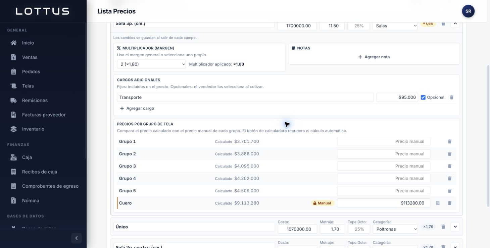
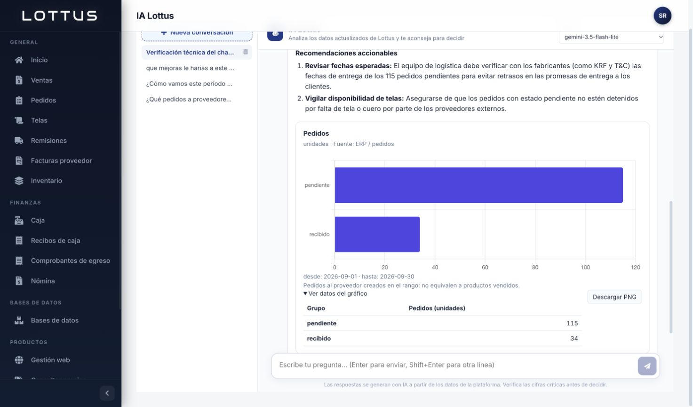

# Corrección del chat y densidad de precios — 2026-10-08

El usuario rechazó el tamaño excesivo de los paneles de referencias/variantes y reportó que el asistente siempre agotaba el tiempo. Esta entrega corrige ambos comportamientos y añade selección de modelo. Cambios locales, sin migraciones nuevas ni despliegue.

## Causa del chat

En `respaldos_locales/runserver.log` se encontraron excepciones `OperationalError (2006, MySQL server has gone away)` dentro de `_procesar`, al guardar el resultado. La conexión del hilo permanecía ociosa durante la llamada a Gemini y el servidor MySQL la cerraba. El manejador de excepciones intentaba guardar el error con ese mismo socket: volvía a fallar y el mensaje quedaba `procesando` hasta el vencimiento de cinco minutos. No era solo un indicador de carga defectuoso.

Además, pruebas mínimas contra el proveedor devolvieron 429/RESOURCE_EXHAUSTED para Gemini 3.8 Flash y 3.5 Flash; 3.7 Flash, 3.6 Flash, 3.5 Flash Lite y 3.1 Flash Lite respondieron. La presencia de un modelo en ListModels no garantiza acceso/cuota: 2.5 Flash figuraba en el catálogo pero devolvió 404 al generar, por lo que no se añadió como alternativa predeterminada.

## Cambios de ejecución

- `gemini.py`: cerrar la conexión de este hilo antes de cada espera HTTP, sin romper transacciones atómicas; reutilizar resultados entre modelos; errores de cuota, indisponibilidad y timeout diferenciados. Clave en cabecera, no URL; mensajes del proveedor no se reflejan sin filtrar. HTTP tiene tiempos máximos de conexión/lectura de 5/40 segundos; el análisis deja de iniciar rondas tras 150 segundos, con una última llamada en curso que puede agotar su timeout. Se conservan límites de rondas/consultas.
- Presupuesto de razonamiento acotado por familia: `thinkingLevel: low` para Gemini 3 y `thinkingBudget: 1024` para Gemini 2.5, si se configura uno explícitamente. Evita consumir toda la ventana de espera en pasos internos. Compatibilidad contrastada con la [documentación oficial de Gemini](https://ai.google.dev/gemini-api/docs/generate-content/thinking). No se garantiza que un modelo externo responda siempre dentro del límite.
- `views.py`: lanzar el hilo después del commit; actualizar solo mensajes aún procesando; reintentar una vez el guardado idempotente tras reconectar. El vencimiento refresca el estado y no pisa una respuesta que acaba de terminar. Un fallo de auditoría tampoco vuelve a convertir una respuesta guardada en error.
- `/api/asistente/estado/` añade `modelos: [{id, aviso}]`; `/api/asistente/preguntar/` acepta `modelo` opcional. Vacío significa automático, con respaldo. La elección explícita se limita a la lista del servidor y se respeta: no se cambia a otro modelo sin indicarlo.
- Orden predeterminado: 3.7 Flash, 3.6 Flash, 3.5 Flash Lite, 3.8 Flash y 3.5 Flash. `GEMINI_MODELOS` permite sustituirlo desde el entorno. No se modificó la clave de la cuenta.
- `ChatPage`: selector disponible antes de enviar y tras errores, modelo real en cada respuesta. Tres fallos consecutivos de sondeo detienen el indicador y ofrecen «Consultar respuesta» sin reenviar la pregunta. Las respuestas de una conversación anterior no reactivan su sondeo al cambiar de vista.

## Editor de precios

Se sustituyó el bloque de estilos grande por uno acotado a `lp-admin-page`. Controles de 28 px, cabeceras de variante de 54 px en el escritorio comprobado, rellenos de 6–10 px, filas de precios de aproximadamente 36 px y secciones sin alturas mínimas decorativas. Ayudas más breves; cifras tabulares; formato manual/calculado conservado. Los estilos mantienen adaptación a pantallas estrechas, aunque la verificación visual de esta entrega se hizo en escritorio.

No se cambiaron mutaciones, operaciones de cálculo ni valores de la base. Se revisó Alaska / Sofá 3p. y sus seis grupos existentes sin guardar modificaciones comerciales.

## Validación

- Backend completo: `DJANGO_ENV_FILE='' testenv/bin/python manage.py test --settings=lottusPedidos.settings_test --noinput` → 319 pruebas descubiertas, 310 correctas y 9 omitidas por requerir MySQL. Los tests usan SQLite desechable; no siembran datos en pruebasv3.
- Nueve nuevas pruebas en `test_chat_resiliencia.py`: selección/lista permitida, ausencia de mensajes para modelo inválido, cierre antes de HTTP y respeto de transacción, reconexión de guardado, respaldo tras 429, timeout frente a 503, protección de mensajes del proveedor, carrera del vencimiento y límite de tiempo.
- Frontend completo: `npm test` → 137 pruebas correctas, 28 suites. Dos nuevas pruebas de cambio de modelo tras fallo y recuperación del sondeo sin duplicar POST. ESLint sin errores, 20 avisos preexistentes. `npx vite build --outDir .build-check --emptyOutDir` correcto.
- Python compilado con `PYTHONPYCACHEPREFIX=/private/tmp/lottus-pycache`; `makemigrations --check --dry-run --settings=lottusPedidos.settings_test` sin cambios.
- En navegador contra localhost:3000/8000 y MySQL real pruebasv3: respuesta técnica real con 3.6 Flash guardada; petición de gráfico que agotó el timeout pasó a error recuperable; tras ajustar el presupuesto y seleccionar 3.5 Flash Lite, «Volver a preguntar» consultó pedidos de septiembre de 2026 y mostró gráfico/tabla con dos estados y 149 pedidos existentes. No se crearon pedidos, ventas ni precios de demostración. La conversación de verificación se conserva como evidencia.

Los registros temporales están en `/private/tmp/lottus-chat-compacto-backend.log`, `lottus-chat-compacto-frontend.log`, `lottus-chat-compacto-lint.log` y `lottus-chat-compacto-build.log`.

## Uso y límites

En IA Lottus, dejar «Automático (con respaldo)» o elegir el modelo antes de enviar. Si aparece un error de cuota/timeout, cambiar el selector y pulsar «Volver a preguntar». Las cuotas son del proveedor; cambiar de modelo puede ayudar si el límite es específico de ese modelo, pero no corrige una cuota global de la cuenta. La carga ya no depende de que un socket MySQL sobreviva a la llamada externa.

Los hilos siguen siendo locales al proceso: un reinicio durante un análisis puede interrumpirlo; el vencimiento existente lo convierte en un error recuperable. Esta entrega no incorpora una cola de trabajos persistente. Los datos empresariales del análisis provienen de la base de pruebas indicada por el usuario. No se intervino producción ni se ejecutó la migración pendiente de Bancos.
